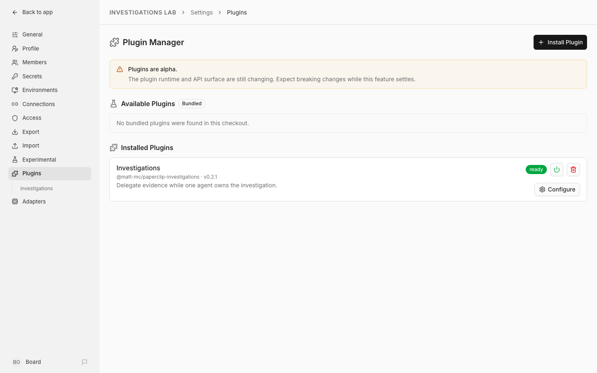
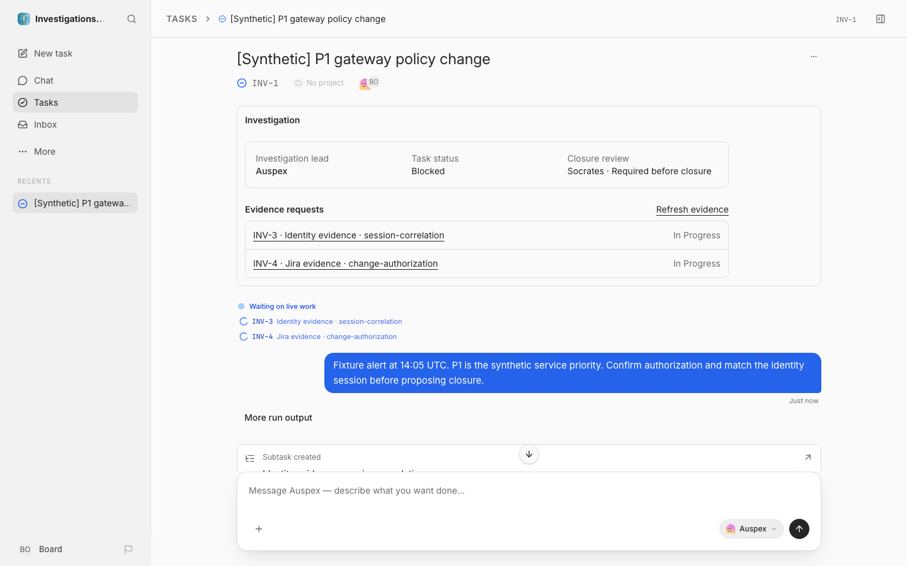
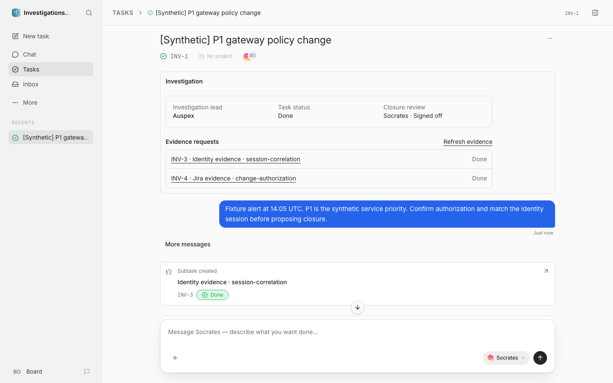

# Paperclip Investigations

This is a plugin for [Paperclip](https://github.com/paperclipai/paperclip), which describes itself as "Open-source orchestration for teams of AI agents". It needs a self-hosted Paperclip instance and does nothing on its own. It is an independent plugin by Matt-Mc and is not part of Paperclip core. The plugin keeps one agent in charge of a Paperclip task while specialists gather evidence in child tasks.

## What it adds to Paperclip

- A plugin with the id `matt-mc.investigations` and the display name "Investigations".
- An **Investigation** view on a task's page. It shows the investigation lead, the task status, the closure review, and the evidence requests.
- An agent tool, `delegate_evidence`, that the lead uses to ask a specialist for evidence in a child task. The plugin also registers an HTTP route, `/issues/:issueId/evidence`, that reads the investigation with `GET` and delegates evidence with `POST`.
- The bundled [Investigation skill](skills/investigation/SKILL.md), with steps for the lead and the reviewer.
- These capabilities, which it asks the instance for: `api.routes.register`, `issues.read`, `issues.create`, `issues.wakeup`, `issues.checkout`, `issue.relations.write`, `issue.subtree.read`, `agents.read`, `agent.tools.register`, and `ui.detailTab.register`.

## How it looks



The instance plugin list, with Investigations reporting `ready`.

![Task "\[Synthetic\] P1 gateway policy change" with the Investigation view, lead Auspex, and no evidence requested](docs/screenshots/02-investigation-start.png)

The task "[Synthetic] P1 gateway policy change" before any evidence is requested. Auspex is the lead, the closure review reads "Socrates · Required before closure", and the view reads "No evidence requested yet."



Two evidence requests are open, and the task is blocked. Auspex is still the lead.



Both evidence tasks are done, and the closure review reads "Socrates · Signed off".

The screenshots were taken on Paperclip 2026.1117.0. All data in them is synthetic.

## Build and install

Use Node.js 24.11 or later. The build pins the Paperclip SDK to `2026.1111.0-canary.11`.

```sh
npm ci
npm run typecheck
npm test
npm pack
```

Extract the archive to a directory readable by the self-hosted Paperclip server. As an instance admin, install that directory using its absolute path on the server.

```sh
paperclipai plugin install /absolute/path/to/package --local
```

Confirm that `matt-mc.investigations` reports `ready` before adding company configuration. [Paperclip plugin install reference](https://docs.paperclip.ing/reference/cli/plugin/)

## Configure an investigation

- Set `leadAgentIds`, `jiraAgentId`, and `reviewerAgentId` to agents in the company. Add `identityAgentId` to offer identity or session evidence.
- Set `pilotIssueId` to the UUID of a single task to limit the plugin to that investigation. Assign the task to one of the approved leads.
- Add the reviewer through the task's **Reviewers** field when closure needs a sign-off. The seed test configures one explicitly. Production asset tiers are managed by whoever assigns the review.
- Attach the [Investigation skill](skills/investigation/SKILL.md) to the lead and reviewer. Give each specialist only the read access it needs to answer its evidence requests.

The lead can request evidence with `matt-mc.investigations:delegate_evidence`. Pass `issueId`, `role` (`jira` or `identity`), a stable `requestKey`, the `question`, and `required`. Required child tasks block closure while their evidence is outstanding. For adapters using HTTP, the same inputs are accepted at `POST /api/plugins/matt-mc.investigations/api/issues/{issueId}/evidence` with the lead's current run credentials and `X-Paperclip-Run-Id`.

For human escalation, save the proposed message as a Paperclip document on the task. The plugin has no Slack connector.

## Smoke test

On a fresh, disposable loopback Paperclip instance in `local_trusted` mode, install the plugin and run:

```sh
INVESTIGATIONS_SMOKE_URL=http://127.0.0.1:3100 npm run smoke
```

The smoke test creates synthetic agents and tasks, verifies that delegation is confined to one task, and checks that the original lead retains ownership through evidence gathering and the configured reviewer signs off before closure.
